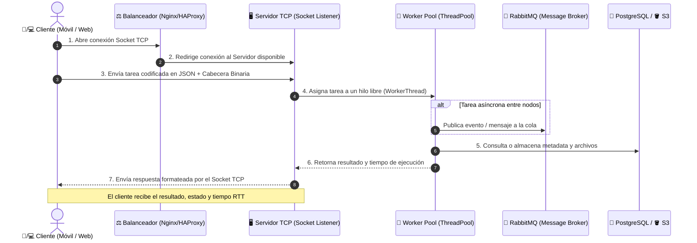
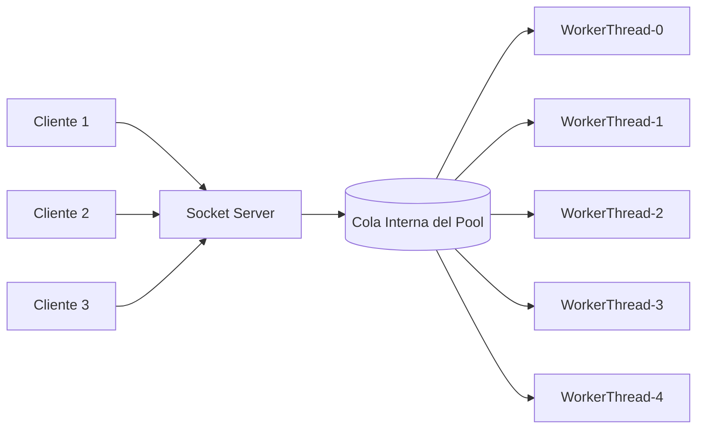

# 📘 Guía de Aprendizaje Paso a Paso: Sistema Distribuido con Sockets y Worker Pool

> **Documento de Estudio y Referencia Técnica**  
> Diseñado para comprender en profundidad la arquitectura, la teoría de redes, la concurrencia multihilo y el funcionamiento línea por línea del código de este proyecto.

---

## 📑 Tabla de Contenidos
1. [Fundamentos Teóricos: ¿Qué es un Sistema Distribuido?](#1-fundamentos-teóricos-qué-es-un-sistema-distribuido)
2. [Arquitectura General y Flujo de Vida de una Tarea](#2-arquitectura-general-y-flujo-de-vida-de-una-tarea)
3. [El Problema del Streaming en TCP y la Solución del Protocolo](#3-el-problema-del-streaming-en-tcp-y-la-solución-del-protocolo)
4. [Diseño y Funcionamiento del Servidor y Worker Pool](#4-diseño-y-funcionamiento-del-servidor-y-worker-pool)
5. [Catálogo de Tareas y Procesamiento de Cómputo](#5-catálogo-de-tareas-y-procesamiento-de-cómputo)
6. [Diseño y Funcionamiento del Cliente](#6-diseño-y-funcionamiento-del-cliente)
7. [Validación y Pruebas de Concurrencia](#7-validación-y-pruebas-de-concurrencia)
8. [Estructura del Proyecto y Buenas Prácticas](#8-estructura-del-proyecto-y-buenas-prácticas)
9. [Preguntas Frecuentes y Conceptos para Examen](#9-preguntas-frecuentes-y-conceptos-para-examen)

---

## 1. Fundamentos Teóricos: ¿Qué es un Sistema Distribuido?

Un **sistema distribuido** es un conjunto de computadoras o procesos independientes que se comunican entre sí mediante una red para coordinar acciones y compartir recursos, presentándose ante el usuario final como un único sistema coherente.

### ¿Por qué transformar un sistema monolítico en distribuido?
- **Escalabilidad Horizontal:** Si un servidor se satura, podemos encender más servidores (workers) en lugar de comprar una máquina más grande.
- **Tolerancia a Fallos:** Si un nodo worker falla, los demás siguen atendiendo peticiones.
- **Desacople:** El cliente que solicita una tarea no necesita saber en qué procesador físico se ejecutará el cómputo.

---

## 2. Arquitectura General y Flujo de Vida de una Tarea

El sistema completo diseñado para esta práctica incluye componentes empresariales de alta disponibilidad:



---

## 3. El Problema del Streaming en TCP y la Solución del Protocolo

### ⚠️ El Gran Problema de los Sockets TCP: "Packet Fragmentation" y "Sticky Packets"
TCP no es un protocolo orientado a mensajes (como UDP), sino un **flujo continuo de bytes (stream)**.
- Si el cliente envía dos mensajes rápidamente: `{"tarea": 1}` y `{"tarea": 2}`, el servidor podría recibirlos juntos en un solo `recv`: `{"tarea": 1}{"tarea": 2}` (lo que causaría un error de sintaxis JSON).
- Si el mensaje es muy largo, el servidor podría recibir solo la mitad en el primer `recv`.

###  La Solución: Framing con Prefijo de Longitud (`src/common/protocol.py`)
Anteponemos a cada mensaje un **encabezado binario fijo de 4 bytes** que indica cuántos bytes mide el payload JSON.

```text
Flujo TCP en tránsito:
┌─────────────────────────┬──────────────────────────────────────────┐
│  4 Bytes de Cabecera    │         N Bytes de Payload JSON          │
│  [Longitud = 38 bytes]  │  {"action": "EXECUTE_TASK", "id": "t1"}  │
└─────────────────────────┴──────────────────────────────────────────┘
```

### Análisis del Código de `protocol.py`:

```python
HEADER_FORMAT = "!I"  # ! = Network byte order (Big-endian), I = Entero sin signo de 4 bytes
HEADER_SIZE = struct.calcsize(HEADER_FORMAT) # Exactamente 4 bytes
```

#### 1. Función `send_message(sock, message)`:
```python
def send_message(sock, message: dict) -> None:
    # 1. Serializa el diccionario a string JSON y luego a bytes UTF-8
    payload = json.dumps(message, ensure_ascii=False).encode("utf-8")
    
    # 2. Empaqueta el tamaño del payload en 4 bytes binarios
    header = struct.pack(HEADER_FORMAT, len(payload))
    
    # 3. Envía ambos juntos por el socket asegurando que todo sea transmitido
    sock.sendall(header + payload)
```

#### 2. Función `recv_all(sock, num_bytes)`:
Esta función es el pilar de la robustez: lee en un bucle hasta completar **exactamente** la cantidad de bytes requerida:
```python
def recv_all(sock, num_bytes: int) -> Optional[bytes]:
    buffer = bytearray()
    while len(buffer) < num_bytes:
        chunk = sock.recv(num_bytes - len(buffer))
        if not chunk: # Si el socket se cerró
            return None
        buffer.extend(chunk)
    return bytes(buffer)
```

#### 3. Función `recv_message(sock)`:
```python
def recv_message(sock) -> Optional[dict]:
    # Paso 1: Leer exactamente los 4 bytes de cabecera
    header = recv_all(sock, HEADER_SIZE)
    if not header:
        return None
        
    # Paso 2: Desempaquetar cuántos bytes mide el cuerpo
    (payload_length,) = struct.unpack(HEADER_FORMAT, header)
    
    # Paso 3: Leer exactamente los bytes del cuerpo
    payload = recv_all(sock, payload_length)
    if payload is None:
        return None
        
    # Paso 4: Deserializar de vuelta a diccionario Python
    return json.loads(payload.decode("utf-8"))
```

---

## 4. Diseño y Funcionamiento del Servidor y Worker Pool

Ubicación: `src/server/server.py`.

El servidor combina dos niveles de concurrencia:
1. **Concurrencia de Conexiones:** Cada cliente que se conecta (`accept()`) es atendido por un hilo independiente (`ClientHandler`).
2. **Concurrencia de Procesamiento (Worker Pool):** Las tareas computacionales se delegan a un `ThreadPoolExecutor` con una cantidad controlada de hilos (`max_workers`).

### ¿Por qué usar un ThreadPool en lugar de crear un hilo por cada tarea?
Si creáramos un hilo nuevo por cada tarea que llega:
- 10.000 tareas crearían 10.000 hilos, consumiendo gigabytes de RAM y colapsando el sistema operativo por *context switching*.
- Con un **ThreadPool de 5 workers**, solo hay 5 hilos ejecutando simultáneamente; las tareas excedentes esperan ordenadamente en una cola interna.



### Métricas Thread-Safe con `threading.Lock`:
Cuando múltiples hilos modifican contadores globales (`tasks_processed`, `active_tasks`), existe el riesgo de **condición de carrera (race condition)**. Para evitarlo:
```python
with self.stats_lock:
    self.tasks_processed += 1
    self.active_tasks -= 1
```

---

## 5. Catálogo de Tareas y Procesamiento de Cómputo

Ubicación: `src/server/tasks.py`.

El procesador `TaskProcessor` implementa 5 tareas representativas para demostrar diferentes tipos de carga:

### 1. `PRIME_CHECK` (Cálculo Matemático Optimizado)
- **Objetivo:** Comprobar si un número es primo.
- **Optimización aplicada:** Algoritmo $6k \pm 1$ hasta $\sqrt{n}$, reduciendo drásticamente las iteraciones frente a la búsqueda ingenua.
- **Ejemplo de solicitud:**
  ```json
  { "task_type": "PRIME_CHECK", "params": { "number": 104729 } }
  ```
- **Ejemplo de respuesta:**
  ```json
  { "number": 104729, "is_prime": true }
  ```

### 2. `FACTORIAL` (CPU-Intensivo)
- **Objetivo:** Calcular factoriales de números grandes (ej. 500!).
- **Respuesta:** Devuelve la cantidad de dígitos y una vista previa sin sobrecargar el payload.

### 3. `HASH_DATA` (Criptografía)
- **Objetivo:** Generar hashes SHA-256 / MD5 / SHA-1 usando `hashlib`.
- **Ejemplo:** Valida integridad de datos transmitidos.

### 4. `WORD_COUNT` (Análisis de Texto)
- **Objetivo:** Análisis léxico, conteo de palabras totales, únicas y caracteres.

### 5. `SIMULATE_PROCESSING` (Simulación I/O Intensivo)
- **Objetivo:** Simula operaciones como consulta a bases de datos remotas o descarga de archivos desde S3 con retardos controlados (`time.sleep`).

---

## 6. Diseño y Funcionamiento del Cliente

Ubicación: `src/client/client.py` y `src/client/cli.py`.

El cliente encapsula toda la complejidad de la conexión:
- **`connect()`:** Establece el socket con un timeout preventivo de 15 segundos para no quedar congelado si el servidor se apaga.
- **`send_task()`:**
  1. Genera un ID único para la tarea con `uuid.uuid4()`.
  2. Registra la estampa de tiempo inicial `t0`.
  3. Envía el mensaje y espera la respuesta del worker.
  4. Calcula la **latencia Round-Trip Time (RTT)**: `round_trip = time.time() - t0`.
- **`get_server_status()`:** Solicita las métricas activas del servidor (hilos en uso, tareas completadas).

---

## 7. Validación y Pruebas de Concurrencia

Ubicación: `tests/test_system.py`.

La suite de pruebas ejecuta 4 tests automatizados:

```text
test_single_task_prime_check  --> Verifica cálculo y asignación correcta de worker.
test_concurrent_clients       --> Lanza 4 clientes en paralelo contra 4 workers;
                                 demuestra que 4 tareas de 0.2s tardan ~0.25s en total
                                 (en lugar de 0.8s secuenciales).
test_error_handling           --> Envía tipos de tareas inexistentes y valida que el
                                 servidor devuelva un error controlado sin caerse.
test_server_status_and_ping   --> Verifica respuesta al comando PING y contadores.
```

Para correr las pruebas:
```bash
python test_system.py
```

---

## 8. Estructura del Proyecto y Buenas Prácticas

El proyecto sigue una arquitectura limpia inspirada en el estándar de empaquetado de Python:

```text
python-sistema-distribuido/
├── src/                          # Código fuente modular
│   ├── common/                   # Protocolo y constantes compartidas
│   │   ├── protocol.py           # Framing binario y JSON sobre TCP
│   │   └── constants.py          # Valores por defecto y tipos de acción
│   ├── server/                   # Lógica del servidor distribuido
│   │   ├── server.py             # Servidor socket y ThreadPoolExecutor
│   │   └── tasks.py              # Procesador de cómputo de tareas
│   └── client/                   # Lógica del cliente distribuido
│       ├── client.py             # Clase cliente con manejo de sockets
│       └── cli.py                # Interfaz por consola interactiva y demo
├── tests/                        # Pruebas automatizadas
│   └── test_system.py            # Suite de integración y concurrencia
├── docs/                         # Documentación y diagramas
│   └── diagrama_arquitectura.svg # Diagrama vectorial de alta resolución
├── run_server.py                 # Punto de entrada para el Servidor
├── run_client.py                 # Punto de entrada para el Cliente
├── README.md                     # Documentación principal en GitHub
├── GUIA_APRENDIZAJE.md           # Esta guía didáctica
└── .gitignore                    # Reglas de exclusión de Git
```

---

## 9. Preguntas Frecuentes y Conceptos para Examen

### 1. ¿Cuál es la diferencia entre Concurrencia y Paralelismo?
- **Concurrencia:** Tratar con muchas cosas a la vez (por ejemplo, el servidor gestiona conexiones de clientes mientras los workers calculan).
- **Paralelismo:** Hacer muchas cosas en el mismo instante físico (posible cuando la máquina dispone de múltiples núcleos de CPU).

### 2. ¿Qué ventaja aporta RabbitMQ en el diagrama arquitectónico?
Permite el **desacople temporal y espacial**:
- Si 1000 clientes envían tareas de golpe y los servidores workers están ocupados, RabbitMQ retiene las tareas de forma segura en un buffer persistente.
- Los workers consumen las tareas a su propio ritmo sin perder ninguna.

### 3. ¿Por qué usamos tanto PostgreSQL como S3 en el almacenamiento distribuido?
- **PostgreSQL:** Excelente para datos relacionales estructurados, consistencia ACID, control transaccional de usuarios, estados y auditoría.
- **Amazon S3 / MinIO:** Diseñado para almacenar archivos binarios, imágenes, modelos o resultados masivos de forma económica, con redundancia geográfica y escalabilidad ilimitada.
