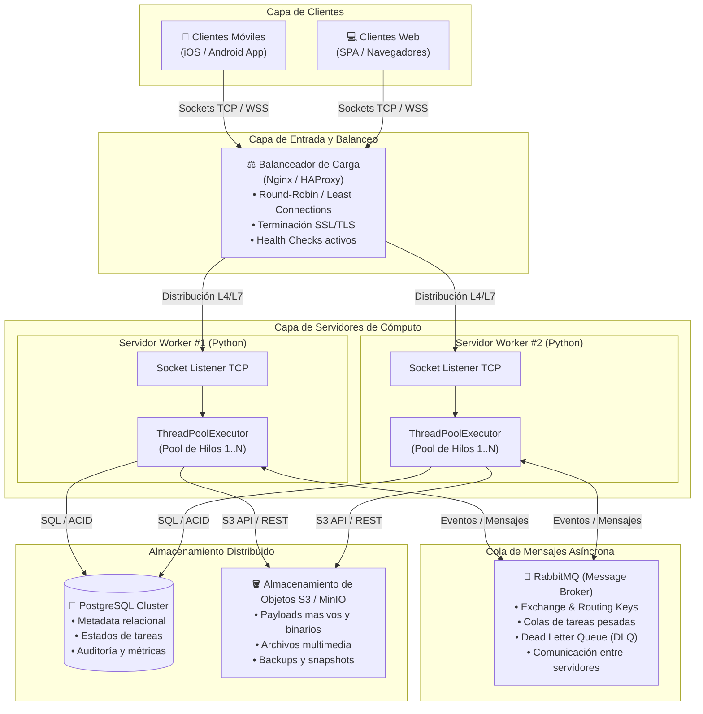

# 🌐 Sistema Distribuido con Sockets y Worker Pool (PFO 3)

[](https://www.python.org/)
[](LICENSE)
[](#1-diagrama-del-sistema-distribuido)
[](GUIA_APRENDIZAJE.md)

Este repositorio contiene la solución profesional completa para la **Práctica Formativa Obligatoria 3 (PFO 3)**, orientada al rediseño y construcción de un sistema con arquitectura distribuida basada en **Sockets TCP**, **Pool de Hilos (Workers)**, y los patrones empresariales de alta disponibilidad requeridos.

> 📚 **¿Quieres aprender cómo funciona el código paso a paso?**  
> Consulta la [**Guía de Aprendizaje Paso a Paso (GUIA_APRENDIZAJE.md)**](GUIA_APRENDIZAJE.md), un documento didáctico completo con teoría de redes, framing TCP, análisis línea por línea y conceptos para examen.

---

## 1. Diagrama del Sistema Distribuido

El diagrama incorpora todos los componentes solicitados en la consigna:
- **Clientes:** Móviles (iOS/Android) y Web (SPA/Navegadores).
- **Balanceador de Carga:** Nginx / HAProxy con balanceo *Round-Robin/Least Connections* y terminación SSL.
- **Servidores Workers:** Nodos de procesamiento concurrentes, cada uno con su respectivo **Pool de Hilos** (`ThreadPoolExecutor`).
- **Cola de Mensajes:** RabbitMQ para comunicación asíncrona, desacople y buffering entre servidores.
- **Almacenamiento Distribuido:** PostgreSQL (consistencia relacional y metadatos) y Amazon S3/MinIO (objetos y payloads pesados).



> **Archivo visual en alta resolución:** También se incluye en la carpeta de documentación el archivo vectorial [`docs/diagrama_arquitectura.svg`](docs/diagrama_arquitectura.svg).

---

## 2. Descripción de los Componentes

| Componente | Rol en el Sistema | Justificación de Diseño |
| :--- | :--- | :--- |
| **Clientes (Móviles / Web)** | Puntos de contacto donde los usuarios generan solicitudes de cálculo o procesamiento. | Se conectan mediante sockets TCP / WebSockets para una comunicación bidireccional y de baja latencia en tiempo real. |
| **Balanceador de Carga (Nginx / HAProxy)** | Punto único de entrada inverso (*Reverse Proxy*) a nivel L4 o L7. | Evita el colapso de un único servidor, distribuye el tráfico y aísla caídas mediante *Health Checks*. |
| **Servidores Workers (Python + ThreadPool)** | Nodos backend que reciben los sockets y delegan las tareas a un **Pool de Hilos concurrentes**. | Permite atender múltiples peticiones en paralelo sin bloquear el socket principal. |
| **Cola de Mensajes (RabbitMQ)** | Broker de mensajería para comunicación desacoplada y asíncrona. | Garantiza que ninguna tarea se pierda ante picos de demanda (*buffering*) y permite reintentos (*DLQ*). |
| **PostgreSQL** | Base de datos relacional transaccional. | Mantiene la consistencia ACID de registros críticos: usuarios, metadatos, estado de tareas y latencias. |
| **Amazon S3 / MinIO** | Almacenamiento de objetos no estructurado y altamente escalable. | Guarda archivos de entrada pesados, resultados voluminosos y logs con disponibilidad 99.999999999%. |

---

## 3. Estructura Profesional del Proyecto

El código está organizado siguiendo las mejores prácticas de modularización en Python:

```text
python-sistema-distribuido/
├── src/                          # Código fuente del sistema
│   ├── common/                   # Componentes compartidos
│   │   ├── __init__.py
│   │   ├── protocol.py           # Framing TCP con prefijo de 4 bytes y JSON
│   │   └── constants.py          # Constantes globales y tipos de acción
│   ├── server/                   # Lógica del Servidor
│   │   ├── __init__.py
│   │   ├── server.py             # Clase DistributedServer y ThreadPoolExecutor
│   │   └── tasks.py              # Procesador de tareas (Primos, Factorial, Hashing, etc.)
│   └── client/                   # Lógica del Cliente
│       ├── __init__.py
│       ├── client.py             # Clase DistributedClient y gestión de sockets
│       └── cli.py                # Interfaz CLI interactiva y suite de demo
├── tests/                        # Suite de pruebas automatizadas
│   ├── __init__.py
│   └── test_system.py            # Tests de integración, concurrencia y errores
├── docs/                         # Documentación y diagramas
│   └── diagrama_arquitectura.svg # Diagrama vectorial SVG del sistema
├── run_server.py                 # Punto de entrada para el Servidor
├── run_client.py                 # Punto de entrada para el Cliente
├── README.md                     # Documentación principal
├── GUIA_APRENDIZAJE.md           # Guía de estudio y tutorial paso a paso
└── .gitignore                    # Reglas de exclusión de Git
```

---

## 4. Guía de Instalación y Ejecución Paso a Paso

Cualquier persona o docente que evalúe este proyecto puede descargarlo y ejecutarlo en cuestión de segundos siguiendo estos pasos:

### Paso 1: Clonar o Descargar el Repositorio
Abre tu terminal (PowerShell, CMD o Bash) y clona el proyecto:
```bash
git clone https://github.com/Animas-Ss/python-sistema-distribuido.git
cd python-sistema-distribuido
```

### Paso 2: Requisitos Previos
- **Python 3.8 o superior** instalado (`python --version`).
- **Cero dependencias externas:** No requiere `pip install` ni entornos virtuales pesados; se desarrolló íntegramente con la biblioteca estándar de Python (`socket`, `concurrent.futures`, `struct`, `json`, `threading`).

---

### Paso 3: Iniciar el Servidor (Terminal 1)
En la primera terminal, inicia el servidor distribuido:
```bash
python run_server.py --port 5000 --workers 4
```
> *(También compatible con: `python server.py`)*

**Salida esperada en consola:**
```text
2026-10-27 14:27:05 [INFO] [MainThread] ====================================================================
2026-10-27 14:27:05 [INFO] [MainThread]  Servidor Distribuido iniciado en 127.0.0.1:5000
2026-10-27 14:27:05 [INFO] [MainThread]  Worker Pool configurado con 4 hilos concurrentes
2026-10-27 14:27:05 [INFO] [MainThread]  Presione Ctrl+C para detener el servidor
2026-10-27 14:27:05 [INFO] [MainThread] ====================================================================
```
El servidor quedará a la espera de peticiones entrantes. Para detenerlo en cualquier momento, simplemente presiona **`Ctrl + C`**.

---

### Paso 4: Ejecutar el Cliente (Terminal 2)
Abre una **segunda terminal** en la misma carpeta para interactuar con el servidor:

#### Opción A: Modo Demostración Automática (Recomendado para evaluación rápida)
Envía automáticamente un lote completo de tareas heterogéneas, midiendo tiempos de procesamiento por hilo y latencia de red (*RTT*):
```bash
python run_client.py --demo
```
> *(También compatible con: `python client.py --demo`)*

**Salida esperada:**
```text
[+] Conectado exitosamente al servidor distribuido en 127.0.0.1:5000

============================================================
 [*] INICIANDO DEMOSTRACION DE TAREAS DISTRIBUIDAS
============================================================

[>] Enviando: Comprobacion de numero primo grande...
------------------------------------------------------------
[OK] Tarea ID:     task-ece352 | Tipo: PRIME_CHECK
    Estado:       SUCCESS
    Worker Hilo:  WorkerThread_0
    Tiempo Proc:  0.0 s
    Latencia RTT: 0.0013 s
    Resultado:    {'number': 104729, 'is_prime': True}
------------------------------------------------------------
...
============================================================
 [+] RESUMEN DE METRICAS DEL SERVIDOR:
    - Estado:              ONLINE
    - Host / Puerto:       127.0.0.1:5000
    - Workers en Pool:     4
    - Tareas completadas:  6
    - Tareas fallidas:     0
============================================================
[*] Conexión cerrada.
```

#### Opción B: Modo Menú Interactivo
Si prefieres ingresar parámetros manualmente a demanda:
```bash
python run_client.py
```
Desplegará el menú interactivo:
```text
==================================================
   SISTEMA DISTRIBUIDO - MENÚ DEL CLIENTE
==================================================
 1. Verificar si un número es primo
 2. Calcular factorial de un número
 3. Generar hash criptográfico (SHA-256)
 4. Contar palabras de un texto
 5. Simular procesamiento con retardo
 6. Ver estado y métricas del servidor
 7. Ejecutar demo automática de tareas
 0. Salir
==================================================
```

---

## 5. Pruebas Automatizadas de Concurrencia

El proyecto incluye una suite formal de pruebas unitarias y de integración que verifica la concurrencia real entre múltiples clientes y el correcto funcionamiento del worker pool:

```bash
python test_system.py
```

**Salida esperada:**
```text
....
----------------------------------------------------------------------
Ran 4 tests in 1.252s

OK
```
Demuestra que 4 clientes enviando tareas simultáneamente tardan apenas ~0.25 segundos gracias a la ejecución paralela en distintos hilos del pool.

