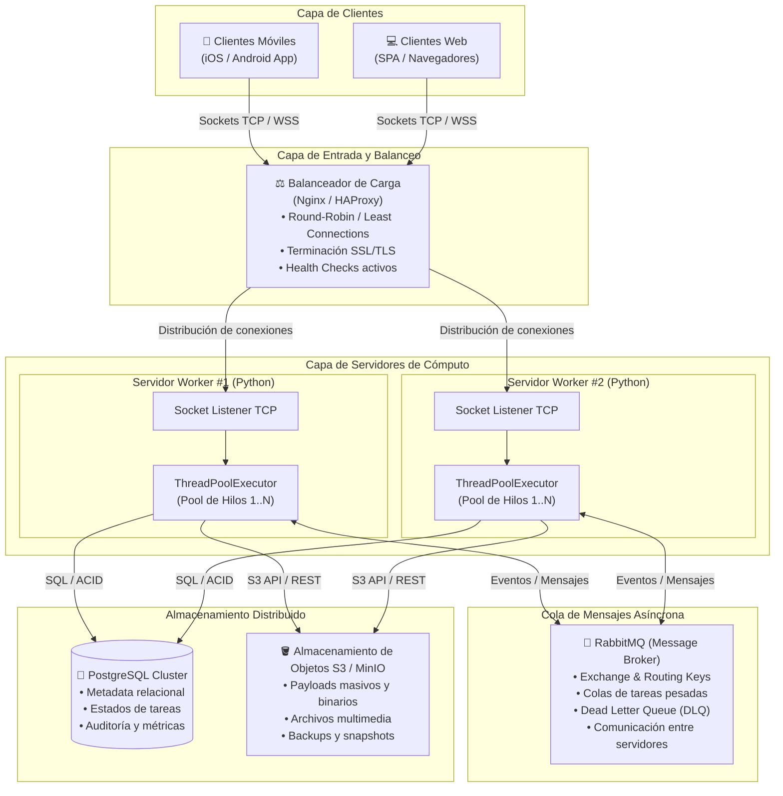

# PFO 3: Rediseño como Sistema Distribuido (Cliente-Servidor)

Este repositorio contiene la solución completa para la **Práctica Formativa Obligatoria 3 (PFO 3)**, orientada al diseño e implementación de un sistema con arquitectura distribuida basada en sockets TCP y componentes empresariales de alta disponibilidad.

---

## 1. Diagrama del Sistema Distribuido

A continuación se presenta el diagrama arquitectónico completo que articula todos los componentes solicitados en la consigna:



> **Archivo visual en alta resolución:** También se incluye en la raíz del repositorio el archivo vectorial [`diagrama_arquitectura.svg`](./diagrama_arquitectura.svg), listo para ser abierto en cualquier navegador o exportado a documentos PDF.

---

## 2. Descripción de los Componentes del Sistema

| Componente | Rol en el Sistema | Justificación de Diseño |
| :--- | :--- | :--- |
| **Clientes (Móviles / Web)** | Puntos de contacto donde los usuarios generan solicitudes de cálculo, análisis de datos o procesamiento. | Se conectan mediante sockets TCP / WebSockets para una comunicación bidireccional y de baja latencia en tiempo real. |
| **Balanceador de Carga (Nginx / HAProxy)** | Punto único de entrada inverso (Reverse Proxy & Load Balancer) a nivel L4 (TCP stream) o L7 (HTTP/WS). | Evita el colapso de un único servidor, distribuye el tráfico usando algoritmos como *Least Connections* y aísla fallos de nodos caídos mediante *Health Checks*. |
| **Servidores Workers (Python + ThreadPool)** | Nodos backend que reciben los sockets de clientes y despachan la carga a un **Pool de Hilos de ejecución concurrente**. | Permite atender múltiples peticiones en paralelo sin bloquear el loop de escucha del socket, aprovechando núcleos del procesador y concurrencia I/O. |
| **Cola de Mensajes (RabbitMQ)** | Broker de mensajería para comunicación desacoplada y asíncrona entre servidores. | Garantiza que ninguna tarea se pierda ante picos de demanda (*buffering*), permite el patrón *Publish/Subscribe* y reintentos ante caídas mediante *Dead Letter Queues*. |
| **PostgreSQL** | Base de datos relacional para almacenamiento estructurado de transacciones. | Mantiene la consistencia ACID de registros críticos: usuarios, metadatos, estado de tareas (`PENDING`, `RUNNING`, `SUCCESS`, `ERROR`) y latencias. |
| **Amazon S3 / MinIO** | Almacenamiento de objetos no estructurado y altamente escalable. | Diseñado para guardar archivos de entrada pesados, resultados voluminosos, logs de auditoría e imágenes con disponibilidad 99.999999999%. |

---

## 3. Implementación en Python

El código implementa el núcleo funcional del sistema distribuido utilizando la librería estándar de Python (`socket`, `concurrent.futures`, `struct`, `json`):

### Estructura de Archivos
- **[`protocol.py`](./protocol.py)**: Define el protocolo de comunicación sobre TCP. Utiliza un encabezado binario de 4 bytes (*big-endian*) que precede al payload JSON, evitando errores clásicos de sockets como *packet fragmentation* o *sticky packets*.
- **[`server.py`](./server.py)**: Servidor socket TCP multihilo. Escucha conexiones entrantes, asigna cada cliente a un gestor y delega las tareas a un `ThreadPoolExecutor` (pool de workers concurrentes). Registra métricas y gestiona cierres limpios.
- **[`client.py`](./client.py)**: Cliente socket con doble modalidad: **interactiva** (menú CLI) y **suite de demo automática** para validar la respuesta inmediata del servidor y los workers.
- **[`test_system.py`](./test_system.py)**: Suite de tests automatizados (`unittest`) que valida la concurrencia real entre múltiples clientes, el uso efectivo de distintos hilos del pool y el manejo de errores.

---

## 4. Requisitos y Ejecución

### Requisitos
- Python 3.8 o superior (se probó con Python 3.10+ / 3.14).
- No requiere dependencias externas (`pip install` no es necesario; se utilizó la biblioteca estándar para máxima portabilidad).

### Paso 1: Iniciar el Servidor
Abra una terminal y ejecute:
```bash
python server.py --host 127.0.0.1 --port 5000 --workers 5
```
Parámetros opcionales:
- `--host`: Dirección IP de escucha (por defecto `127.0.0.1`).
- `--port`: Puerto de escucha (por defecto `5000`).
- `--workers`: Cantidad de hilos en el worker pool (por defecto `5`).

### Paso 2: Ejecutar el Cliente

#### Modo Demostración Automática (Recomendado para testing rápido):
En otra terminal, ejecute:
```bash
python client.py --demo
```
Este modo enviará automáticamente una batería de tareas heterogéneas (números primos, factoriales, hashing criptográfico SHA-256, conteo de palabras y simulación concurrente) y mostrará las métricas del pool de workers.

#### Modo Interactivo:
```bash
python client.py
```
Desplegará un menú por consola para enviar tareas a demanda:
```text
=============================================
 SISTEMA DISTRIBUIDO - MENÚ CLIENTE
=============================================
 1. Verificar si un número es primo
 2. Calcular factorial de un número
 3. Generar hash criptográfico (SHA-256)
 4. Contar palabras de un texto
 5. Simular procesamiento con delay
 6. Ver estado y métricas del servidor
 7. Ejecutar demo automática de tareas
 0. Salir
=============================================
```

### Paso 3: Ejecutar las Pruebas Automatizadas
Para verificar el comportamiento integral y la concurrencia:
```bash
python test_system.py
```

---

## 5. Instrucciones para Subir al Repositorio de GitHub

Para publicar esta entrega en tu cuenta de GitHub, sigue estos pasos desde la terminal dentro de esta carpeta:

1. **Inicializar Git y agregar archivos:**
   ```bash
   git init
   git add .
   git commit -m "feat: implementacion inicial del sistema distribuido con sockets y worker pool (PFO 3)"
   ```

2. **Crear repositorio en GitHub:**
   - Ingresa a [GitHub](https://github.com/new) y crea un nuevo repositorio llamado por ejemplo `python-sistema-distribuido`.
   - Deja las opciones de inicializar con README o .gitignore desmarcadas.

3. **Vincular el repositorio remoto y subir el código:**
   ```bash
   git branch -M main
   git remote add origin https://github.com/TU_USUARIO/python-sistema-distribuido.git
   git push -u origin main
   ```
